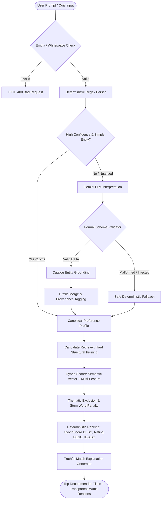

<div align="center">

# CineVerse 🎬
### Next-Gen OTT Streaming Discovery & Hybrid AI Recommendation Engine

[](http://13.203.136.117:3000)
[](https://react.dev/)
[](https://www.typescriptlang.org/)
[](https://nodejs.org/)
[](https://expressjs.com/)
[](https://www.mysql.com/)
[](https://ai.google.dev/)
[](https://aws.amazon.com/)

<br/>

**⚡ Sub-40ms Query Response** &nbsp;•&nbsp; 
**🎬 10,000+ Titles Catalog** &nbsp;•&nbsp; 
**🧠 384-Dim Vector Embeddings** &nbsp;•&nbsp; 
**🔮 CineMatch Hybrid AI Recommender** &nbsp;•&nbsp; 
**🛡️ Strict Schema & Exclusion Boundary**

<br/>

### 🚀 **[Live Website: http://13.203.136.117:3000](http://13.203.136.117:3000)**

</div>

---

## 🌐 Live Production Deployment

CineVerse is deployed and actively serving traffic from an **AWS EC2 (Mumbai - `ap-south-1`)** cloud instance:

* 🚀 **Live Web Application**: **[http://13.203.136.117:3000](http://13.203.136.117:3000)**

### Quick Endpoint Links

| Component | Production URL | Description |
| :--- | :--- | :--- |
| 🎬 **Web App (Frontend)** | [http://13.203.136.117:3000](http://13.203.136.117:3000) | Full responsive React single-page application |
| 🩺 **Backend Health Check** | [http://13.203.136.117:3000/api/health](http://13.203.136.117:3000/api/health) | Node.js REST API status & timestamp |
| 🔮 **CineMatch Recommender** | [http://13.203.136.117:3000/api/movies/recommend](http://13.203.136.117:3000/api/movies/recommend) | Hybrid semantic & multi-factor constraint engine |
| 🌟 **Featured Movies API** | [http://13.203.136.117:3000/api/movies/featured](http://13.203.136.117:3000/api/movies/featured) | Top-rated high-definition hero carousel data |
| 🔥 **Trending Content API** | [http://13.203.136.117:3000/api/movies/trending](http://13.203.136.117:3000/api/movies/trending) | Real-time trending movie & series collection |
| 🏷️ **Genres API** | [http://13.203.136.117:3000/api/movies/genres](http://13.203.136.117:3000/api/movies/genres) | 25 distinct indexed genre categories |
| 🔍 **Search API** | [http://13.203.136.117:3000/api/movies/search?q=Inception](http://13.203.136.117:3000/api/movies/search?q=Inception) | Multi-entity search with streaming providers & trailers |

---

## 💡 Overview

**CineVerse** is a commercial-grade, full-stack Over-The-Top (OTT) content discovery and rights management system designed to eliminate streaming fragmentation. Powered by an enterprise **3NF normalized MySQL database**, CineVerse pairs a comprehensive catalog of **10,000+ titles** with **verified streaming deep-linking** (Netflix, Amazon Prime Video, Disney+, Apple TV+, Max, Paramount+, and Crunchyroll). 

It features an in-app official YouTube trailer player, instant **0ms page loads** via client-side Stale-While-Revalidate (SWR) caching, and the **CineMatch** recommendation engine that unifies dense semantic vector embeddings, LLM prompt interpretation, strict exclusion filters, and multi-factor hybrid scoring.

---

## 🔮 The CineMatch Hybrid Recommendation Engine

CineMatch solves the "decision fatigue" problem through two distinct discovery workflows:

### 1. Guided Quiz Mode
A structured, interactive quiz capturing user preferences across:
* **Experience & Vibe**: *Thought-Provoking*, *Feel-Good*, *Thrilling*, *Cozy*, *Mind-Bending*, *Dark & Gritty*, *Escapist*
* **Content Type**: *Movies*, *Series*, or *Any*
* **Runtime Budget**: *Under 90 min*, *Around 2 hours*, *Epic (150+ min)*, or *Binge-worthy Series*
* **Era**: *Classic (< 1980)*, *Modern (1980–2010)*, or *Recent (2010+)*
* **Quality Threshold**: Minimum rating and vote volume weighting

### 2. Custom Natural Language Request Mode
Users can describe their exact mood or constraints in plain English (e.g., *"Intense psychological suspense where nobody gets murdered"* or *"Korean romantic comedy series on Netflix released after 2018"*).



### Key Engineering Capabilities
* **Dual-Layer Interpretation**: Fast deterministic parsing for explicit lookups ($<15\text{ ms}$) paired with Google Gemini 1.5 Flash fallback for rich semantic reasoning.
* **Formal Schema-Validation Boundary**: LLM output is schema-validated before merging into preference profiles. Primitive roots, unexpected fields, and out-of-bound values are strictly rejected.
* **Catalog-Grounded Entity Resolution**: Reference titles, actors, and directors returned by the LLM are validated against the database. Unmatched entities are quarantined to `unresolved_*` fields and never become verified constraints.
* **Provenance Tagging (`user` vs `llm`)**: User-stated genres act as hard candidate filters; LLM-inferred genres act as soft scoring preferences, preventing model hallucinations from blocking valid titles.
* **Hard Exclusion Enforcement**: Plot exclusions (*"no murders or killings"*), scene-level exclusions (*"without graphic violence"*), thematic exclusions (*"avoid child abuse"*), tonal preferences (*"nothing with a tragic ending"*), and franchise bans (*"no superhero films"*, *"not Spider-Man"*) are enforced via morphological stem expansion and candidate pruning.
* **Deterministic Ranking**: Results are sorted strictly by `HybridScore DESC, rating DESC, ContentID ASC`—guaranteeing zero randomness, zero MMR degradation, and 100% reproducible orderings.
* **Transparent, Non-Hallucinated Match Reasons**: Match explanations (e.g., *"Matches your requested Sci-Fi & Fantasy genre"*, *"Avoids graphic violence while matching your requested tone"*) require affirmative metadata evidence and never claim safety on conflicting content.

---

## ✨ Features

* ⚡ **Instant 0ms Navigation (Client SWR Cache)**: State initializes synchronously from persistent in-memory and `sessionStorage` caching on the first frame—eliminating layout shifts.
* 🔗 **Verified Global Streaming Deep-Links**: Automatically detects availability across Netflix, Prime Video, Disney+, Apple TV+, Max, Paramount+, and Crunchyroll.
* 🎬 **Universal In-App Official YouTube Trailer Modal**: Integrated responsive YouTube trailer modal on every title.
* 🌲 **Hierarchical TV Series Architecture**: Fully models complex relationships across a 3-tier recursive tree: `Series ➔ Season ➔ Episode`, tracking individual episode durations and titles across 30,000+ episodes.
* 👥 **Comprehensive Cast & Crew Credits**: Tracks actors, directors, character roles, profile images, and collection franchises.
* 🌐 **Multilingual Audio & Subtitle Tracking**: Distinguishes between `Original`, `Dubbed`, and `Subtitle` language tracks across global film libraries.
* 🚀 **High-Throughput Backend Optimization**: Uses pre-indexed $O(1)$ Hash Map hydration in Node.js instead of nested SQL queries, assembling complex relations in under 35ms.

---

## 🗄️ Relational Schema (3NF Architecture)

The database schema is organized into **18 normalized tables** in MySQL:

```
• actor              (actor_id [PK], name, profile_path, tmdb_actor_id)
• director           (director_id [PK], name, profile_path, tmdb_director_id)
• genre              (genre_id [PK], genre_name [UNIQUE])
• language           (language_id [PK], language_name [UNIQUE])
• ott_platform       (platform_id [PK], name [UNIQUE])

• content            (content_id [PK], title, release_year, type, tmdb_id [UNIQUE],
                      poster_path, backdrop_path, rating, description, trailer_key)
• movie              (content_id [PK, FK ➔ content], duration)
• series             (content_id [PK, FK ➔ content], total_seasons)

• season             (season_id [PK], series_id [FK ➔ series], season_number)
• episode            (episode_id [PK], season_id [FK ➔ season], title, episode_number, duration)

• content_actor      (content_id [PK, FK ➔ content], actor_id [PK, FK ➔ actor], role_name)
• content_director   (content_id [PK, FK ➔ content], director_id [PK, FK ➔ director])
• content_genre      (content_id [PK, FK ➔ content], genre_id [PK, FK ➔ genre])
• content_language   (content_id [PK, FK ➔ content], language_id [PK, FK ➔ language], 
                      type [PK, ENUM('Original', 'Dubbed', 'Subtitle')])
• content_platform   (content_id [PK, FK ➔ content], platform_id [PK, FK ➔ ott_platform], 
                      available_from [PK], available_till, region)
• episode_language   (episode_id [PK, FK ➔ episode], language_id [PK, FK ➔ language], type [PK])
• watchlist          (watchlist_id [PK], content_id, content_name, release_year, type, poster_path, rating)
• content_dna        (content_id [PK, FK ➔ content], dna_json, updated_at)
```

---

## 📚 Technical Documentation

Detailed architectural and design documents are available in the [`docs/`](docs/) directory:

| Document | Description |
| :--- | :--- |
| 📖 [**Recommendation Engine Architecture**](docs/RECOMMENDATION_ENGINE.md) | Full technical specification of candidate retrieval, embedding vectors, and hybrid scoring. |
| 🛡️ [**LLM Interpretation Layer Design**](docs/LLM_INTERPRETATION_LAYER_DESIGN.md) | Formal schema validation, catalog grounding, error boundaries, and provenance tracking. |
| 🔍 [**Actor & Director Search**](docs/ACTOR_DIRECTOR_SEARCH.md) | Person entity disambiguation, multi-person matching modes, and credit extraction. |
| 🧬 [**Movie DNA Feature Dictionary**](docs/MOVIE_DNA_FEATURE_DICTIONARY.md) | Complete taxonomy of vector attributes, thematic tags, and scoring weights. |
| 📊 [**Recommendation Quality Evaluation**](docs/RECOMMENDATION_QUALITY_EVALUATION.md) | Comprehensive 30-scenario baseline evaluation methodology and findings. |
| 📈 [**Quality Tuning Phase 2 Report**](docs/RECOMMENDATION_QUALITY_TUNING_PHASE_2.md) | Empirical analysis of hybrid weight tuning and deterministic constraint satisfaction. |

---

## 🚀 Quickstart & Local Installation

### Prerequisites
* **Node.js**: v18.0.0 or higher
* **MySQL Server**: 8.0 or higher
* **Google Gemini API Key** (Optional, for LLM fallback in Custom Request mode)

### 1. Database Initialization
```bash
# Log in to MySQL and initialize the schema
mysql -u root -p
CREATE DATABASE project;
EXIT;

# Import the database tables
mysql -u root -p project < backend/schema.sql
```

### 2. Backend Setup
```bash
cd backend

# Install dependencies
npm install

# Configure environment variables
cp .env.example .env
# Edit .env and supply your credentials:
# DB_PASSWORD=your_mysql_password
# GEMINI_API_KEY=your_gemini_api_key (optional)

# Build TypeScript
npm run build

# Start backend server
npm run dev
```
> API runs at `http://localhost:5000`

### 3. Frontend Setup
```bash
cd ../frontend

# Install dependencies
npm install

# Launch Vite development server
npm run dev
```
> Open **`http://localhost:3000`** in your browser.

---

## 🧪 Automated Testing & Verification

Run the dedicated test suites in `backend`:

```bash
cd backend

# 1. Strict Schema Validation & Entity Grounding Unit Tests
node dist/test_schema_validation.js

# 2. Negative Constraints & Content Exclusions Test Suite
node dist/test_negative_constraints.js

# 3. 76-Scenario Evaluation Runner Across 14 Categories
node dist/evaluate_60_prompts.js
```

---

## 📁 Repository Directory Structure

```
├── backend/                       # Express.js REST API (TypeScript)
│   ├── src/
│   │   ├── controllers/           # Movie and recommendation HTTP route controllers
│   │   ├── db/                    # MySQL connection pool
│   │   ├── models/                # TypeScript interfaces and preference profile schemas
│   │   ├── repositories/          # SQLMovieRepository & data access layer
│   │   ├── routes/                # Express API router definitions
│   │   ├── services/
│   │   │   ├── customPromptParser.ts         # Deterministic regex prompt parser
│   │   │   ├── llmPromptParser.ts            # Gemini LLM interpretation & schema validator
│   │   │   ├── preferenceProfileBuilder.ts   # Profile synthesizer & provenance merger
│   │   │   └── recommendation/               # Hybrid recommendation engine pipeline
│   │   │       ├── candidateRetriever.ts     # Hard structural candidate filters
│   │   │       ├── embeddingStore.ts         # 384-dim in-memory vector store
│   │   │       ├── featureScorer.ts          # Multi-feature match score computation
│   │   │       ├── hybridScorer.ts           # Hybrid scorer with negative penalty rules
│   │   │       ├── explanationGenerator.ts   # Truthful match reason generator
│   │   │       └── recommendationEngine.ts   # Top-level engine orchestrator
│   │   └── test_*.ts              # Unit and integration test suites
│   ├── schema.sql                 # MySQL 3NF database DDL schema
│   ├── .env.example               # Environment variable template
│   └── package.json
├── frontend/                      # React 18 single page application (Vite)
│   ├── src/
│   │   ├── api/                   # API client and SWR caching layer
│   │   ├── components/            # Reusable UI components & modals
│   │   ├── pages/                 # HomePage, CineMatchPage, MovieDetailPage, SearchPage
│   │   └── utils/                 # LocalStorage persistence utilities
│   ├── index.html
│   └── package.json
├── docs/                          # Comprehensive technical architecture and design docs
├── scripts/                       # Database backfill, DNA building, and utility scripts
├── .gitignore                     # Root gitignore
└── README.md                      # Project documentation
```

---

<div align="center">
  <sub>Built with ❤️ for High-Performance Digital Content Management and Universal Streaming Discovery.</sub>
</div>
