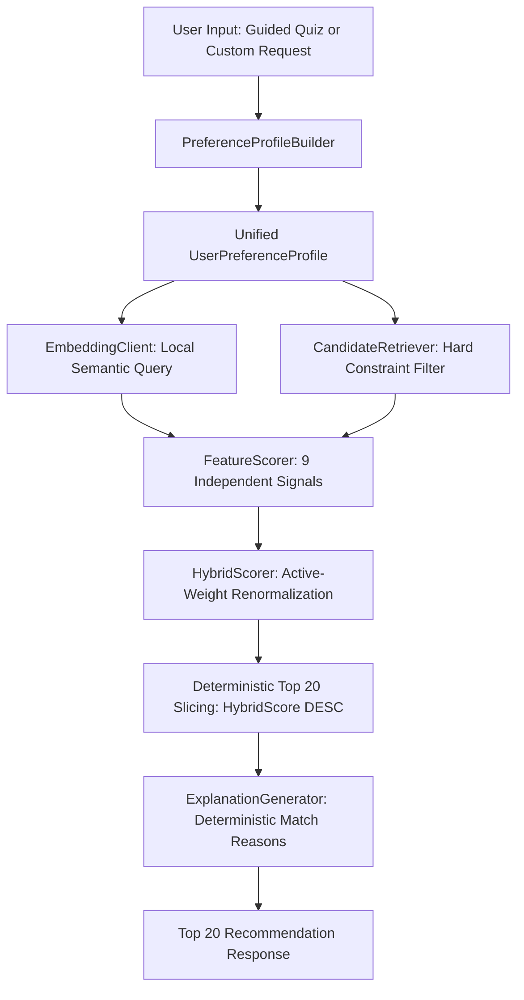

# CineVerse Hybrid Content-Based Recommendation Engine

This document provides the architectural specification, mathematical formulas, scoring models, and operational details for the CineVerse Recommendation Engine.

---

## 1. Architecture

The CineVerse Recommendation Engine implements a multi-stage, explainable **Hybrid Content-Based Retrieval and Reranking Pipeline**. It merges structured metadata from `MovieDNA` with dense semantic vectors computed by a local sentence embedding model (`all-MiniLM-L6-v2`), applying transparent heuristic scoring and diversity-aware reranking.

Both **Guided Quiz** and **Custom Request** modes funnel into this exact same engine:



### Key Principles
1. **No External Cloud APIs**: No OpenAI, Gemini, or external vector SaaS databases. Operates 100% locally and deterministically.
2. **Offline Precomputation**: All 10,000 catalog embeddings are precalculated and cached in binary format (`data/movie_embeddings.bin`).
3. **Dual-Constraint Model**: Strict separation of Hard Constraints (Type, explicit custom Platform/Language, exact runtime, exact era bounds) and Soft Preferences (Era, Quality, Experience, Runtime).
4. **Dynamic Active-Weight Renormalization**: Unspecified preferences do not artificially lower relevance scores; active dimensions renormalize to 100%.
5. **Pure Relevance Ranking**: Final ranking is determined strictly and monotonically by the Hybrid Score (`HybridScore DESC, Rating DESC, ContentID ASC`), without artificial diversity penalties, MMR, or clustering.
6. **Transparent Explanations**: Explanations are generated deterministically based strictly on active contributing signals.

---

## 2. Movie Embedding Construction

Embeddings represent **CONTENT and STORY**, avoiding popularity, runtime, or availability signals that are handled by dedicated feature scoring functions.

- **Offline Script**: [`scripts/build_movie_embeddings.py`](file:///c:/Users/Lenovo/Music/Project/Digital-Movie-Content-Management-System/scripts/build_movie_embeddings.py)
- **Model**: `sentence-transformers/all-MiniLM-L6-v2` (384-dimensional dense vectors, float32, L2-normalized).
- **Storage**: Binary file `data/movie_embeddings.bin` with `CIN1` 16-byte magic header, followed by contiguous records: `[int32 content_id, float32[384] vector]`. Metadata logged in `data/movie_embeddings_meta.json`.

### Structured Movie Semantic Text Format
```text
Title: Interstellar
Type: Movie
Genres: Adventure, Drama, Sci-Fi & Fantasy
Description: A team of explorers travel through a wormhole in space in an attempt to ensure humanity's survival.
Year: 2014
```
For Series, format metadata is appended (e.g., `Series format: 5 seasons, 62 episodes`).

---

## 3. User Query Construction

The user semantic query is constructed dynamically by [`EmbeddingClient`](file:///c:/Users/Lenovo/Music/Project/Digital-Movie-Content-Management-System/backend/src/services/recommendation/embeddingClient.ts):

### A. Guided Profiles
Guided profiles translate the 5 canonical experience choices into rich concept intent expansions (not genre assignments):
- `thought_provoking`: `"thought-provoking, intellectually engaging, complex ideas, interesting concepts, mentally stimulating, surprising, mind-bending themes"`
- `funny`: `"humorous, comedic, playful, entertaining, light-hearted, witty, hilarious, laugh-out-loud"`
- `thrilling`: `"suspenseful, tense, exciting, dangerous, fast-paced, edge of your seat, heart-pounding"`
- `emotional`: `"heartfelt, moving, emotionally powerful, poignant, human relationships, deeply touching"`
- `escapist`: `"immersive, adventurous, imaginative, entertaining, transportive, fantastical world"`

If genres or themes are present, they are appended to enrich the query text.

### B. Custom Profiles
For custom requests:
- The raw `free_text` (e.g., `"I want something emotional but not too depressing."`) forms the core of the query, preserving nuances and negative constraints.
- Extracted themes and qualifiers are appended as context.

---

## 4. Experience-Intent Representation

Crucially, **experiences are NOT one-to-one mapped to genres**:
- `thought_provoking` $\neq$ Sci-Fi. It spans Sci-Fi, Mystery, Drama, Documentary, and History.
- `emotional` $\neq$ Drama. It spans Romance, Animation, Family, Documentary, and War.

The primary experience signal is dense semantic cosine similarity between the candidate movie and the experience intent vector. A gentle prior (0.10) can reward aligned genres, but semantic story relevance remains dominant.

---

## 5. Candidate Retrieval

[`CandidateRetriever`](file:///c:/Users/Lenovo/Music/Project/Digital-Movie-Content-Management-System/backend/src/services/recommendation/candidateRetriever.ts) caches all 10,000 `MovieDNA` records in memory alongside MySQL `content.poster_path`.

- Candidate pool filtering evaluates hard constraints in $<2\text{ ms}$.
- Target pool size: **500 to 10,000 titles**.
- If constraints yield fewer than 20 titles (e.g., rare Korean series on a specific platform), all valid candidates are preserved without silent relaxation.

---

## 6. Hard vs Soft Constraints

| Constraint | Type | Behavior |
| :--- | :--- | :--- |
| **Content Type** (`Movie` vs `Series`) | Hard | Strict filter when explicitly specified. If `null`, both are allowed. |
| **Custom Platform** (e.g., "on Netflix") | Hard | Only titles available on requested platform are retrieved. |
| **Custom Language** (e.g., "in Korean") | Hard | Only titles with matching audio/dub are retrieved. |
| **Era Preference** (`recent`, `modern`, `classic`) | Soft | Smooth Gaussian/decay curve; never excludes older or newer content. |
| **Quality Preference** (`high`, `medium`, `low`) | Soft | Alters the weight of TMDB rating; does not eliminate mid-tier titles. |
| **Runtime Commitment** (`around_2_hours`, etc.) | Soft | Continuous bell curve around target duration. |
| **Experience / Mood** | Soft | Continuous dense semantic similarity. |

---

## 7. Scoring Components

Every retrieved candidate receives 9 normalized scores in $[0.0, 1.0]$:

### 1. Semantic Content Score ($S_{\text{sem}}$)
Cosine similarity between the user query vector $\vec{u}$ and candidate movie vector $\vec{m}$:
$$S_{\text{sem}} = \text{clamp}\left(\frac{\vec{u} \cdot \vec{m} + 0.2}{1.2}, 0.0, 1.0\right)$$

### 2. Experience Intent Score ($S_{\text{exp}}$)
Cosine similarity against the experience intent vector:
$$S_{\text{exp}} = \text{clamp}\left(\frac{\vec{e} \cdot \vec{m} + 0.1}{1.1}, 0.0, 1.0\right)$$

### 3. Explicit Genre Overlap ($S_{\text{gen}}$)
Weighted Jaccard similarity across canonical 25-genre taxonomy:
$$S_{\text{gen}} = \frac{|\mathcal{G}_{\text{user}} \cap \mathcal{G}_{\text{movie}}|}{|\mathcal{G}_{\text{user}}|}$$
Neutral ($0.50$) if no user genre preference is specified.

### 4. Reference Similarity ($S_{\text{ref}}$)
Max similarity across cached embeddings of resolved reference titles $\mathcal{R}$:
$$S_{\text{ref}} = \max_{r \in \mathcal{R}} \left(\vec{m}_r \cdot \vec{m}\right)$$

### 5. Runtime Fit ($S_{\text{run}}$)
- **Movies**:
  - `under_2_hours`: $1.0$ if duration $\le 115\text{ min}$, smooth linear decay to $0.0$ at $160\text{ min}$.
  - `around_2_hours`: Bell curve peaked at $115\text{ min}$:
    $$S_{\text{run}} = \exp\left(-\frac{(d - 115)^2}{2 \times 32^2}\right)$$
  - `long_movie_ok`: Neutral/positive ($1.0$ if $\ge 120\text{ min}$, $0.85$ otherwise).
- **Series**: Evaluated against total seasons and episode depth without penalizing missing durations.
- **Reference-Relative**: When `shorter_than_reference` is requested, compares against $d_{\text{ref}}$, NOT $120\text{ min}$.

### 6. Era Fit ($S_{\text{era}}$)
Smooth temporal decay based on `release_year`:
- `recent`: $1.0$ for $\ge 2020$, gradual linear decay to $0.40$ for $2000$.
- `modern`: $1.0$ for $2000 \le \text{year} \le 2019$, tapering off symmetrically.
- `classic`: $1.0$ for $<2000$, tapering off towards 2010.

### 7. Quality Fit ($S_{\text{qua}}$)
Normalized TMDB rating:
$$S_{\text{qua}} = \text{clamp}\left(\frac{\text{rating}}{10.0}, 0.0, 1.0\right)$$
- If `quality_flags.is_unreleased == true` and `rating == 0`, assigned neutral $0.70$ rather than penalized.

### 8. Language Match ($S_{\text{lang}}$)
$1.0$ on exact match with candidate primary or available audio languages; $0.50$ if neutral.

### 9. Platform Match ($S_{\text{plat}}$)
$1.0$ on exact match with candidate streaming platform; $0.50$ if neutral.

---

## 8. Initial Heuristic Weights

> [!NOTE]
> These weights are **initial heuristic hypotheses**, not claimed to be globally optimal. They are located in [`backend/src/services/recommendation/weights.ts`](file:///c:/Users/Lenovo/Music/Project/Digital-Movie-Content-Management-System/backend/src/services/recommendation/weights.ts) for continuous tuning.

```typescript
export const INITIAL_WEIGHTS = {
  semantic: 0.30,      // Semantic content similarity
  experience: 0.15,    // Experience intent description
  genre: 0.15,         // Explicit genre overlap
  reference: 0.10,     // Reference title similarity
  runtime: 0.10,       // Duration / season commitment fit
  era: 0.07,           // Temporal release era fit
  quality: 0.07,       // TMDB rating importance
  language: 0.03,      // Primary / dub language match
  platform: 0.03,      // Streaming platform match
};
// Total Sum = 1.00 (100%)
```

---

## 9. Active-Weight Renormalization

When a user omits certain dimensions (e.g., no platform, no genre, no reference title), inactive dimensions are dropped and remaining active weights are scaled:

$$w_i' = \frac{w_i}{\sum_{j \in \text{Active}} w_j}$$

The hybrid score is then strictly:
$$\text{HybridScore} = \sum_{i \in \text{Active}} w_i' \cdot S_i + \text{bonus}_{\text{actor}}$$

This prevents unconstrained dimensions from depressing candidate scores.

---

## 10. Reference-Title Similarity & Quality Tuning

When users request titles like `"I want something like Interstellar"`:
1. `CandidateRetriever` resolves `"Interstellar"` to canonical `content_id = 189` and extracts its `ReferenceProfile` (genres: `Adventure, Drama, Sci-Fi & Fantasy`, runtime: `169 min`, type: `Movie`).
2. The user semantic query vector is enriched with the reference title's genre elements (`thematic elements of Adventure, Drama, Sci-Fi & Fantasy`).
3. For each candidate, reference affinity combines:
   - **Semantic Similarity** ($S_{\text{sem}}$): Cosine similarity between candidate embedding and reference title embedding.
   - **Reference-Aware Genre Prior** ($G_{\text{aff}}$): Overlap ratio between reference genres and candidate genres ($\frac{|\mathcal{G}_{\text{ref}} \cap \mathcal{G}_{\text{cand}}|}{|\mathcal{G}_{\text{ref}}|}$, with neutral $0.5$ fallback if either is missing).
   - **Format Consistency** ($F_{\text{align}}$): Soft $10\%$ preference if candidate type matches reference type ($1.0$ if matching, $0.90$ if differing).
4. **Combined Reference Affinity Formula**:
   $$\text{RefAffinity} = \left(0.75 \cdot S_{\text{sem}} + 0.25 \cdot G_{\text{aff}}\right) \cdot F_{\text{align}}$$
   - Prevents generic thematic matches from dominating reference-specific genre worlds (e.g. elevates *Spaceman*, *Star Trek Beyond*, *Stargate* over generic non-Sci-Fi dramas).
   - Genre overlap remains a soft ranking prior, never a hard exclusion filter.
5. Reference breakdown details (`semantic_similarity`, `genre_affinity`, `combined_affinity`) are exposed in `score_breakdown.reference_details` for full transparency.

---

## 11. Runtime Relation Handling

When users specify `"something like Interstellar but shorter"`:
- The engine identifies reference movie runtime ($169\text{ min}$).
- The runtime preference does **NOT** hardcode a 120-minute cap.
- Candidates with duration $< 169\text{ min}$ (e.g., *Stargate* at 126 min, *Don't Look Up* at 138 min) receive full runtime credit.

---

## 12. Missing Data Handling

- **Actor Metadata**: Only 6.96% coverage in catalog. Missing actor data is strictly neutral ($0.0$ bonus) and never penalizes content.
- **Unreleased Titles**: Titles with `rating = 0` and `quality_flags.is_unreleased = true` receive a default quality score ($0.70$) rather than $0.0$.
- **Series Episodes**: Series lacking detailed per-episode duration are judged solely on season count.

---

---

## 13. Deterministic Ranking & Top 20 Selection

CineVerse ranks candidates **strictly and exclusively** by individual relevance:

- **MMR Removal**: Maximal Marginal Relevance (MMR), diversity reranking penalties, and intra-list similarity calculations have been completely removed.
- **Pure Relevance Priority**: Recommendations are sorted monotonically by `HybridScore DESC`. If two candidates have equal hybrid scores, tie-breaking is deterministic:
  $$\text{Sort Order} = \left[\text{HybridScore} \downarrow, \, \text{Rating} \downarrow, \, \text{ContentID} \uparrow\right]$$
- **Top 20 Selection**: The top 20 candidates from the sorted pool are selected. If fewer than 20 candidates satisfy all hard constraints, the actual count is returned without relaxing any constraints.
- **Similarity Invariance**: Inter-item similarity between candidates does not alter ranking. Related sequels or common franchises will rank alongside each other if their relevance scores justify it.

---

## 14. Explanation Generation

Explanations are generated deterministically by [`ExplanationGenerator`](file:///c:/Users/Lenovo/Music/Project/Digital-Movie-Content-Management-System/backend/src/services/recommendation/explanationGenerator.ts).
- No LLM hallucinations.
- Explanations only reference signals that actually achieved high match values.
- Truthful qualifiers: e.g., `"Runtime (109 min) closely fits your ~2-hour preference"`, `"Similar to Interstellar in narrative tone and thematic style"`.

---

## 15. API Specification

### Endpoint: `POST /api/movies/recommend`

#### Request Body
```json
{
  "profile": {
    "source": "guided",
    "experience": ["thought_provoking"],
    "type": "Movie",
    "genres": [],
    "languages": [],
    "platforms": [],
    "runtime_preference": "around_2_hours",
    "runtime_relation": null,
    "era_preference": "recent",
    "quality_preference": "high",
    "themes": [],
    "reference_titles": [],
    "free_text": null
  },
  "debug": true
}
```

#### Response Body
```json
{
  "success": true,
  "count": 20,
  "recommendations": [
    {
      "content_id": 1420,
      "title": "David",
      "type": "Movie",
      "poster_path": "/abc.jpg",
      "rating": 8.0,
      "release_year": 2025,
      "recommendation_score": 0.785,
      "match_percentage": 79,
      "score_breakdown": {
        "semantic": 0.65,
        "experience": 0.72,
        "genre": 0.50,
        "reference": 0.50,
        "runtime": 0.90,
        "era": 1.00,
        "quality": 0.92,
        "language": 0.50,
        "platform": 0.50
      },
      "match_reasons": [
        "Strong match for a thought-provoking experience",
        "Runtime (109 min) closely fits your ~2-hour preference",
        "Recent release (2025)"
      ]
    }
  ],
  "debug": {
    "candidate_pool_size": 6253,
    "top_candidates": [...],
    "active_weights": {...},
    "execution_time_ms": {
      "query_embedding_ms": 20,
      "candidate_retrieval_ms": 1,
      "feature_scoring_ms": 55,
      "total_ms": 80
    }
  }
}
```

---

## 16. Performance Benchmarks

Measured on standard local workstation (Windows 11, Node.js + Python local embedding service):

| Phase | Latency |
| :--- | :--- |
| **Offline Embedding Generation (10,000 items)** | ~70 seconds (one-time batch) |
| **Server Boot Initialization (Cache Load)** | 250–350 ms |
| **Query Embedding Generation** | 15–20 ms |
| **Candidate Retrieval (10,000 titles in memory)** | 0–2 ms |
| **9-Feature Scoring (6,000+ candidates)** | 50–65 ms |
| **Deterministic Sorting & Slicing** | < 1 ms |
| **Total End-to-End API Response Time** | **~70–90 ms** |

---

## 17. Known Limitations

1. **Catalog Metadata Sparsity**:
   - 93% of titles lack cast/crew credits; actor matching is strictly an optional bonus.
   - Platform availability is limited to current catalog records; titles missing streaming data are treated as neutral.
2. **Local Embedding Daemon Dependency**:
   - Requires `scripts/embedding_service.py` running on localhost:5002 for query embedding. If offline, the engine falls back to structured metadata matching.
3. **Short Description Granularity**:
   - Titles with very short TMDB synopses (under 10 words) yield less nuanced semantic vectors than titles with detailed loglines.

---

## 18. Future Tuning Opportunities

1. **Direct C++ / Rust SIMD Vector Dot Product**: Replace JavaScript Float32Array loop with SIMD bindings to reduce 10,000-candidate scoring time from 55ms to $<10$ms.
2. **Fine-Tuned Loss for Movie DNA**: Train a contrastive adapter on TMDB user co-watch pairs.

